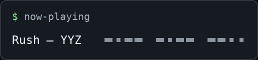

# Guilherme Barroso

**Full-stack engineer at  [Introzy](https://introzy.com/)**\
Master’s degree from Universitat Autònoma de Barcelona (UAB)\
Rio de Janeiro, Brazil 🇧🇷 · [LinkedIn](https://www.linkedin.com/in/gmbarroso/)

I’ve spent over a decade building web apps and APIs and leading distributed, multicultural engineering teams. I use ChatGPT and Claude to explore implementation options, and I’m experimenting with LLM-powered agents to plan, implement, and test changes.

 **[blab.ti](https://www.blabti.com/) · Portfolio**\
A selection of independent projects I’ve taken on alongside my full-time work.

 **[SeuZé.tech](https://seuze.tech) · Side project**\
I started SeuZé in 2021 as a volunteer project for my condo community. It grew after my neighbors started using it, and I’m now turning it into a product for other condo communities in my spare time.

